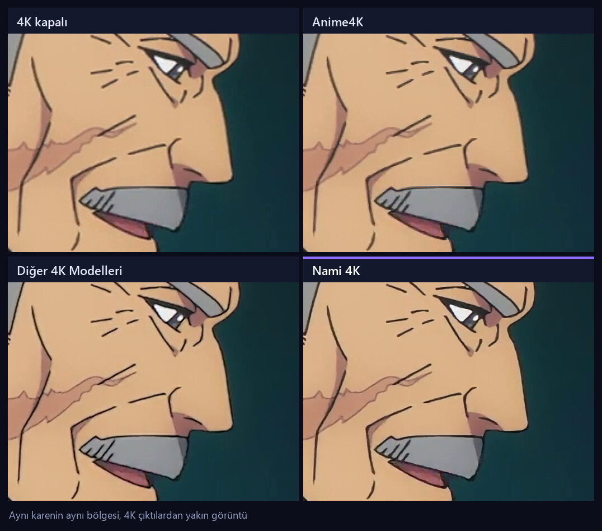

Nami, anime için kendi eğittiğimiz bir 4K büyütme modeli. Bölümü daha yüksek çözünürlükte gösterirken çizgileri keskin, düz renk alanlarını temiz tutmaya çalışıyor. Oynatıcıya Anime4K'nın yanında ikinci bir seçenek olarak geliyor; izleme sayfasındaki ayarlardan seçebilirsin.

## Başlangıç

Amacımız anime için hem daha doğru hem daha hafif bir büyütme modeliydi. İşe verinin kendisine bakarak başladık ve ilk sürprizi orada yaşadık: 1080p diye yayınlanan animelerin çoğu aslında daha düşük çözünürlükte üretilip büyütülmüş. Kendi kaynaklarımızı ölçtüğümüzde gerçek çözünürlük 877 satır civarında çıktı. İlk hazırladığımız eğitim verisi bu yüzden gerçekçi değildi.

## Geliştirme

Eğitim verisini stüdyoların büyütme ve sıkıştırma izlerini taklit edecek şekilde baştan kurduk. Modeli kendi bilgisayarımızda, ekran kartında eğitiyoruz; eğitilen model tarayıcıda ekran kartında çalışacak şekilde dışa aktarılıyor.

Ezber yapmasın diye bazı seriler eğitime hiç girmiyor: karanlık ve efekt yoğun bir seri, 640×480 bir SD seri ve modelin hiç görmediği bir bölüm. Gerçek bir sınav için de One Piece'in aynı bölümünün 480p, 720p ve 1080p hallerini kare kare hizaladık. Bölümü 4 dakikalık bloklara ayırıp blokları sırayla eğitime ve sınava verdik, aralarına 15 saniyelik boşluk bıraktık.

Sonuca tek bir puanla bakmıyoruz. Çizgi kenarındaki haleyi, düz alanlardaki gürültüyü, renk saçağını, kareden kareye titremeyi ve çizgi keskinliğini ayrı ayrı ölçüyor, kararları yan yana koyduğumuz kesitlere bakarak veriyoruz.

## Sonuç

Aynı karenin aynı bölgesini dört farklı şekilde büyüttük: 4K kapalıyken, Anime4K ile, diğer 4K modelleriyle ve Nami ile.

Bu sınavda son Nami sürümü, Anime4K'nın en büyük modeline karşı karelerin %71'inde daha doğru sonuç verdi. Sitedeki sürümde çizgiler daha belirgin görünsün diye keskinliği biraz artırdık. Bu yüzden ölçülen doğrulukta Anime4K'nın az gerisinde kalıyor, diğer bir 4K modelinin ise 1,24 dB önünde. FPS Artırma açıkken 1080p'de Nami gecikmeye neredeyse bir şey eklemiyor: 4K kapalıyken de açıkken de 58 ms, Anime4K'nın en ağır ayarında bu 68-69 ms. Ekran kartının çektiği güç de Nami ile yaklaşık 30 W, Anime4K'nın en ağır ayarıyla 83 W civarında.

Üzerinde çalıştığımız konu çizgi kenarlarındaki hafif renk saçağı. Sebebi tarayıcının videonun renk bilgisini bizim eğitim verimizden farklı bir yöntemle büyütmesi; bunu kapatan bir düzeltme hazırlıyoruz. SD kaynaklar için ayrı bir model de yolda.

Kod ve model dosyaları bu depoda yok, Deokwave kapalı kaynak.

[deokwave.com](https://deokwave.com) · [Discord](https://discord.gg/deokwave) · [Deokwave GitHub](https://github.com/Deokwave)
